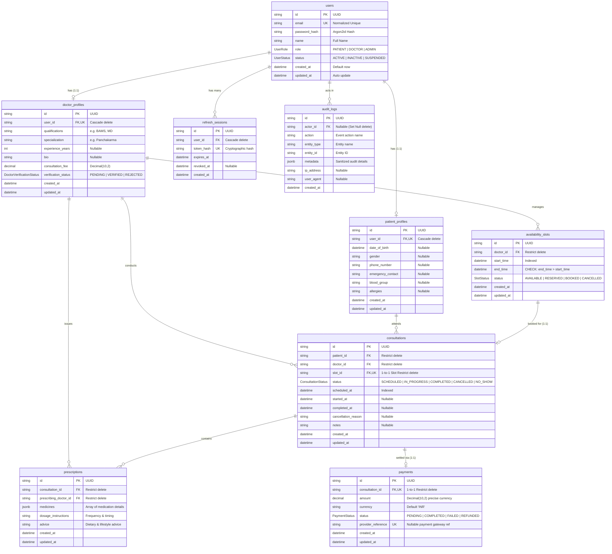

# Amrutam Telemedicine Backend - Entity Relationship Diagram

This document illustrates the data architecture and relational constraints implemented in **Phase 2 (Database Schema and Migrations)** using PostgreSQL and Prisma ORM.

