# Amrutam Telemedicine Backend — Entity Relationship Diagram

This document describes the complete relational data architecture, entities, attributes, constraints, indexes, and referential actions implemented in the **Amrutam Telemedicine Backend** using PostgreSQL and Prisma ORM.

---

## 1. Relational Entity Diagram

```mermaid
erDiagram
    users ||--o| patient_profiles : "has profile (1:1)"
    users ||--o| doctor_profiles : "has profile (1:1)"
    users ||--o| user_mfa : "enrolled in (1:1)"
    users ||--o{ refresh_sessions : "maintains sessions"
    users ||--o{ audit_logs : "records actions"
    users ||--o{ idempotency_records : "scopes writes"

    doctor_profiles ||--o{ availability_slots : "schedules slots"
    doctor_profiles ||--o{ consultations : "assigned to"
    doctor_profiles ||--o{ prescriptions : "issues"

    patient_profiles ||--o{ consultations : "attends"

    availability_slots ||--o| consultations : "booked for (1:1)"

    consultations ||--o{ prescriptions : "contains"
    consultations ||--o| payments : "settled via (1:1)"

    users {
        string id PK "UUID"
        string email UK "Case-insensitive normalized unique"
        string password_hash "Argon2id cryptographic hash"
        string name "User full legal name"
        UserRole role "PATIENT | DOCTOR | ADMIN"
        UserStatus status "ACTIVE | INACTIVE | SUSPENDED"
        datetime created_at "Default now()"
        datetime updated_at "Auto update"
    }

    patient_profiles {
        string id PK "UUID"
        string user_id FK,UK "1-to-1 users (Cascade delete)"
        datetime date_of_birth "Nullable"
        string gender "Nullable"
        string phone_number "Nullable contact phone"
        string emergency_contact "Nullable emergency phone"
        string blood_group "Nullable ABO blood type"
        string allergies "Nullable recorded allergies"
        datetime created_at
        datetime updated_at
    }

    doctor_profiles {
        string id PK "UUID"
        string user_id FK,UK "1-to-1 users (Cascade delete)"
        string qualifications "e.g. BAMS, MD (Ayurveda)"
        string specialization "e.g. Panchakarma, Kayachikitsa"
        int experience_years "Years of clinical practice"
        string bio "Professional biography"
        decimal consultation_fee "Decimal(10,2) in INR"
        DoctorVerificationStatus verification_status "PENDING | VERIFIED | REJECTED"
        datetime created_at
        datetime updated_at
    }

    user_mfa {
        string id PK "UUID"
        string user_id FK,UK "1-to-1 users (Cascade delete)"
        boolean is_enabled "TOTP active flag"
        string secret_encrypted "AES-256-GCM ciphertext (iv:tag:data)"
        datetime enrolled_at "Enrollment timestamp"
        datetime last_verified_at "Last TOTP challenge verification"
        datetime created_at
        datetime updated_at
    }

    availability_slots {
        string id PK "UUID"
        string doctor_id FK "doctor_profiles.id (Restrict delete)"
        datetime start_time "Indexed slot start (UTC)"
        datetime end_time "Indexed slot end (CHECK: end_time > start_time)"
        SlotStatus status "AVAILABLE | RESERVED | BOOKED | CANCELLED"
        datetime created_at
        datetime updated_at
    }

    consultations {
        string id PK "UUID"
        string patient_id FK "patient_profiles.id (Restrict delete)"
        string doctor_id FK "doctor_profiles.id (Restrict delete)"
        string slot_id FK,UK "availability_slots.id (1:1 Restrict delete)"
        ConsultationStatus status "SCHEDULED | IN_PROGRESS | COMPLETED | CANCELLED | NO_SHOW"
        datetime scheduled_at "Indexed scheduled appointment time"
        datetime started_at "Nullable consultation commencement"
        datetime completed_at "Nullable consultation conclusion"
        string cancellation_reason "Nullable cancellation note"
        string notes "Nullable clinical notes"
        datetime created_at
        datetime updated_at
    }

    prescriptions {
        string id PK "UUID"
        string consultation_id FK "consultations.id (Restrict delete)"
        string prescribing_doctor_id FK "doctor_profiles.id (Restrict delete)"
        jsonb medicines "Array of {name, dosage, frequency, duration}"
        string dosage_instructions "Clinical administration schedule"
        string advice "Dietary and lifestyle advice"
        datetime created_at
        datetime updated_at
    }

    payments {
        string id PK "UUID"
        string consultation_id FK,UK "1-to-1 consultations.id (Restrict delete)"
        decimal amount "Decimal(10,2) precise currency amount"
        string currency "Default 'INR'"
        PaymentStatus status "PENDING | COMPLETED | FAILED | REFUNDED"
        string provider_reference UK "External payment reference"
        datetime created_at
        datetime updated_at
    }

    audit_logs {
        string id PK "UUID"
        string actor_id FK "users.id (Nullable, SetNull on delete)"
        string action "Event name (e.g. CONSULTATION_STARTED)"
        string entity_type "Entity name (e.g. Consultation)"
        string entity_id "Entity UUID"
        jsonb metadata "Sanitized audit details (PII-free)"
        string ip_address "Nullable client IP"
        string user_agent "Nullable client user agent"
        datetime created_at "Indexed event timestamp"
    }

    refresh_sessions {
        string id PK "UUID"
        string user_id FK "users.id (Cascade delete)"
        string token_hash UK "SHA-256 hash of refresh token"
        datetime expires_at "Session expiry timestamp"
        datetime revoked_at "Nullable revocation timestamp"
        datetime created_at
    }

    idempotency_records {
        string id PK "UUID"
        string user_id FK "users.id (Cascade delete)"
        string operation "Operation name (e.g. booking:create)"
        string idempotency_key "Client-provided idempotency key"
        string request_hash "SHA-256 payload fingerprint"
        string resource_id "Nullable associated entity UUID"
        jsonb response_body "Cached API response payload"
        datetime created_at
        datetime expires_at "Indexed TTL expiry"
    }
```

---

## 2. Table Specifications & Indexes

### 2.1. `users`
- **Primary Key**: `id` (UUIDv4)
- **Unique Constraints**: `email` (indexed, lowercase normalized)
- **Role Enum**: `PATIENT`, `DOCTOR`, `ADMIN`
- **Status Enum**: `ACTIVE`, `INACTIVE`, `SUSPENDED`

### 2.2. `patient_profiles` & `doctor_profiles`
- **Primary Key**: `id` (UUIDv4)
- **Foreign Key**: `user_id` $\rightarrow$ `users(id)` with `ON DELETE CASCADE`.
- **Unique Constraints**: Exactly one profile record per user (`user_id` is `@unique`).
- **Doctor Verification Enum**: `PENDING`, `VERIFIED`, `REJECTED`.
- **Indexes**:
  - `doctor_profiles(verification_status, specialization)` for fast directory search.

### 2.3. `availability_slots`
- **Primary Key**: `id` (UUIDv4)
- **Foreign Key**: `doctor_id` $\rightarrow$ `doctor_profiles(id)` with `ON DELETE RESTRICT`.
- **Constraints**: Database check constraint enforcing `end_time > start_time`.
- **Status Enum**: `AVAILABLE`, `RESERVED`, `BOOKED`, `CANCELLED`.
- **Indexes**:
  - `availability_slots(doctor_id, start_time, end_time)` for overlap detection.
  - `availability_slots(status, start_time)` for booking availability queries.

### 2.4. `consultations`
- **Primary Key**: `id` (UUIDv4)
- **Foreign Keys**:
  - `patient_id` $\rightarrow$ `patient_profiles(id)` (`ON DELETE RESTRICT`)
  - `doctor_id` $\rightarrow$ `doctor_profiles(id)` (`ON DELETE RESTRICT`)
  - `slot_id` $\rightarrow$ `availability_slots(id)` (`ON DELETE RESTRICT`, unique 1:1)
- **Status Enum**: `SCHEDULED`, `IN_PROGRESS`, `COMPLETED`, `CANCELLED`, `NO_SHOW`.
- **Indexes**:
  - `consultations(patient_id, scheduled_at)`
  - `consultations(doctor_id, scheduled_at)`
  - `consultations(status, scheduled_at)`

### 2.5. `prescriptions`
- **Primary Key**: `id` (UUIDv4)
- **Foreign Keys**:
  - `consultation_id` $\rightarrow$ `consultations(id)` (`ON DELETE RESTRICT`)
  - `prescribing_doctor_id` $\rightarrow$ `doctor_profiles(id)` (`ON DELETE RESTRICT`)
- **JSON Column**: `medicines` contains structured array of medications (`[{ name, dosage, frequency, duration }]`).

### 2.6. `idempotency_records`
- **Primary Key**: `id` (UUIDv4)
- **Unique Compound Constraint**: `@@unique([user_id, operation, idempotency_key])`.
  - Ensures idempotency keys are strictly scoped per authenticated user and operation.
- **Index**: `@@index([expires_at])` for background TTL cleanup.

### 2.7. `user_mfa`
- **Primary Key**: `id` (UUIDv4)
- **Foreign Key**: `user_id` $\rightarrow$ `users(id)` (`ON DELETE CASCADE`, unique 1:1).
- **Security**: `secret_encrypted` stores authenticated AES-256-GCM ciphertext (`iv:tag:data`).
