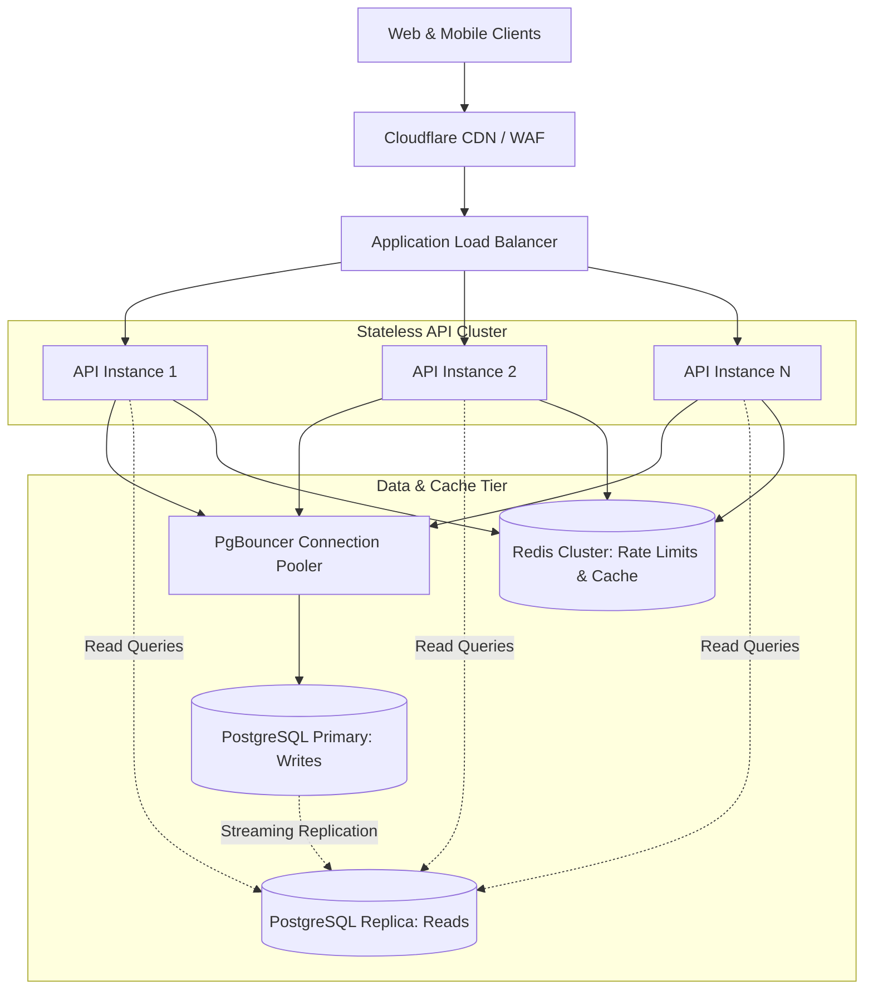

# Amrutam Telemedicine Backend — Reliability, Caching, Partitioning & Scalability

This document details the operational characteristics, fault-tolerance mechanisms, caching strategies, and horizontal scaling roadmap for the **Amrutam Telemedicine Backend**.

---

## 1. Request Retries & Idempotency Guarantees

### 1.1. Safe vs. Unsafe Retries
In a distributed telemedicine application, network failures can occur between client and server, or between server and database. Operations must be strictly classified before enabling automated retries:

| Operation Type | Endpoints / Workflows | Retry Safety | Mechanism & Policy |
| :--- | :--- | :--- | :--- |
| **Idempotent Reads** | `GET /doctors`, `GET /consultations/:id`, `GET /metrics` | **Safe** | Naturally idempotent. Safe for immediate client or proxy retry with exponential backoff. |
| **Idempotency-Protected Writes** | `POST /api/v1/bookings` | **Safe with Key** | Client must supply the same `Idempotency-Key` header. If the initial request succeeded before connection dropped, server replays the original response (`isReplay: true`) without creating a duplicate booking. |
| **State Machine Transitions** | `POST /consultations/:id/start`, `POST /consultations/:id/complete` | **Conditional** | Transitions enforce atomic state preconditions (`WHERE status = 'SCHEDULED'`). If retried after already starting, returns `409 Conflict (INVALID_STATUS_TRANSITION)`. |
| **Blind Writes (Unsafe)** | `POST /prescriptions` | **Unsafe without Check** | If retried blindly without an idempotency key, could create duplicate prescription records. Handled via consultation ID scoping. |

### 1.2. Retry Guidelines & Exponential Backoff
When building mobile and web frontend clients:
- **Jittered Exponential Backoff**: Implement Decorrelated Jitter:
  $$\text{delay} = \min(\text{max\_delay}, \text{base\_delay} \times 2^{\text{attempt}} \pm \text{random\_jitter})$$
- **Avoid Thundering Herd**: Never retry immediately upon receiving `HTTP 503` or network timeout without a randomized delay.

---

## 2. Caching Strategy & Authoritative State

### 2.1. Current Cache Implementation (Redis)
- **Rate-Limiting Counters**: Active sliding-window counters for `authRateLimiter` (`rl:auth:*`) and `mfaRateLimiter` (`rl:mfa:*`).
- **Resilient Fallback**: If Redis crashes, limiters gracefully fall back to in-memory tracking without terminating HTTP traffic.

### 2.2. Recommended Read-Cache Opportunities (Roadmap)
1. **Doctor Directory Search (`GET /api/v1/doctors`)**:
   - Cache key: `cache:doctors:search:hash(query)`
   - TTL: 5 minutes.
   - Invalidation: Event-driven eviction when an administrator updates verification status or doctor edits profile.
2. **Public System Metadata**: Medical specializations, qualifications, and platform terms.

### 2.3. The "Authoritative Database" Golden Rule
> [!CRITICAL]
> **Availability slots and booking decisions MUST NEVER be evaluated against a cached state.**  
> Slot reservations require atomic row-level guarantees. Caching slot availability creates high vulnerability to stale reads and double-booking races. All booking transactions query and update PostgreSQL directly.

---

## 3. Database Indexing & Table Partitioning

### 3.1. Current Query Indexes
The Prisma schema defines strategic B-tree indexes matching core operational queries:
- `users(email)`: Case-insensitive unique login lookup.
- `availability_slots(doctor_id, start_time, end_time)`: Fast slot queries and overlap checks.
- `availability_slots(status, start_time)`: Fast search for bookable `AVAILABLE` slots.
- `consultations(patient_id, scheduled_at)`: Patient appointment history.
- `consultations(doctor_id, scheduled_at)`: Doctor clinical schedule.
- `audit_logs(entity_type, entity_id)` & `audit_logs(created_at)`: Forensic audits.
- `idempotency_records(expires_at)`: Expired key eviction.

### 3.2. Future Table Partitioning Strategy
As platform traffic expands into millions of historical consultations, table partitioning should be introduced on high-volume tables:

```sql
-- Recommended Range Partitioning for audit_logs by month:
CREATE TABLE audit_logs_partitioned (
    id UUID NOT NULL,
    actor_id UUID,
    action VARCHAR(255) NOT NULL,
    entity_type VARCHAR(255) NOT NULL,
    entity_id VARCHAR(255) NOT NULL,
    metadata JSONB,
    created_at TIMESTAMP WITH TIME ZONE DEFAULT NOW() NOT NULL,
    PRIMARY KEY (id, created_at)
) PARTITION BY RANGE (created_at);

-- Example Monthly Partitions:
CREATE TABLE audit_logs_2026_10 PARTITION OF audit_logs_partitioned
    FOR VALUES FROM ('2026-10-01 00:00:00+00') TO ('2026-11-01 00:00:00+00');
```
Benefits:
- Eliminates index degradation on multi-million row tables.
- Facilitates instant archival or deletion of older partition tables without locking active writes.

---

## 4. Connection Pooling & Resource Limits

### 4.1. Connection Bottlenecks
Node.js processes open persistent connections to PostgreSQL via Prisma Client. In high-concurrency environments, unmanaged connection growth can exhaust database connection pools:
- **Direct PostgreSQL Max Connections**: Typically 100–300 connections on standard cloud instances.
- **Prisma Default Pool Size**: $\text{num\_physical\_cpus} \times 2 + 1$.

### 4.2. Recommended Architecture
1. **Prisma Accelerate or PgBouncer**:
   - Connection routing through PgBouncer connection pooler (`port 6543`).
   - Transaction-mode pooling enables thousands of concurrent client requests over a compact pool of 20–50 physical PostgreSQL connections.
2. **Direct Connection for Migrations**:
   - Schema migrations (`prisma migrate deploy`) require session-level locking and must always bypass PgBouncer using `DIRECT_URL` (`port 5432`).

---

## 5. Horizontal Scaling Roadmap



### 5.1. Statelessness Guarantees
The Express API instances are **completely stateless**:
- Sessions are tokenized via signed JWTs or tracked in PostgreSQL/Redis.
- No local file uploads are stored on container filesystems.
- Containers can be scaled horizontally from 1 to 50 replicas behind an Application Load Balancer without session stickiness requirements.
