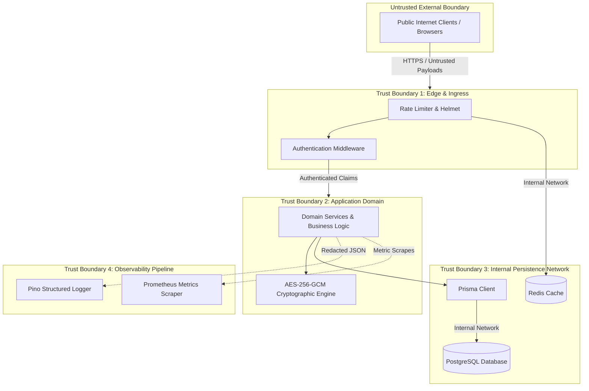

# Amrutam Telemedicine Backend — Security Threat Model

**Methodology**: STRIDE / OWASP Top 10 API Security  
**Target Architecture**: Node.js Express / PostgreSQL / Redis / Docker  
**Status**: Prototype Security Baseline

---

## 1. System Assets & Sensitivity Classification

| Asset Category | Specific Assets | Classification | Impact of Compromise |
| :--- | :--- | :--- | :--- |
| **Authentication & IAM** | Password hashes (Argon2id), JWT signing keys, refresh token hashes, TOTP MFA secrets | **Critical** | Complete account takeover, identity spoofing, and unauthorized administrative actions. |
| **Protected Health Info (PHI)** | Patient profiles, medical histories, allergies, clinical consultation notes, electronic prescriptions | **Critical** | Severe patient privacy violation, medical identity theft, and regulatory non-compliance. |
| **Doctor Credentials** | Medical registration qualifications, specialization, consultation fees, verification state | **High** | Fraudulent medical practice, impersonation of licensed practitioners. |
| **Financial & Scheduling** | Slot availability records, consultation bookings, payment records, idempotency keys | **High** | Financial discrepancies, denial of medical service, double-booking chaos. |
| **System Security & Audit** | Database connection strings, AES-256-GCM encryption keys, audit logs, Prometheus metrics | **Critical** | Total infrastructure compromise, forensic evidence tampering. |

---

## 2. Trust Boundaries

### 2.1. Attack Surface Analysis

The system exposes four distinct attack surfaces requiring hardened defensive postures:

| Surface | Exposure Vector | Attack Vectors | Hardened Defense Strategy |
| :--- | :--- | :--- | :--- |
| **Network & Transport Surface** | Ingress ports (`5000` API, `3000` Grafana, `9090` Prometheus) | Port scanning, DDoS, SSL stripping, man-in-the-middle (MitM) eavesdropping. | TLS 1.3 encryption, Helmet HTTP security headers (HSTS, X-Content-Type-Options), internal Docker network isolation for Prometheus and Grafana. |
| **API & Application Surface** | 22 REST endpoints, query parameters, JSON payloads, headers | Injection, parameter tampering, mass assignment, IDOR, brute force, rate-limit bypassing. | Zod `.strict()` schema validation, Argon2id hashing, RFC 6238 TOTP MFA, Redis sliding-window rate limiters, route normalization. |
| **Data & Storage Surface** | PostgreSQL database tables, Redis keys, disk logs, volumes | SQL injection, unauthorized table dumps, log file scraping, key tampering. | Parameterized queries via Prisma ORM, AES-256-GCM authenticated encryption at rest for TOTP secrets, automated Pino sensitive field redaction. |
| **Human & Operational Surface** | Admin portal credentials, MFA seed enrollment, deployment scripts | Phishing, credential stuffing, privileged operator misuse, secret leakage in Git. | Zero real credentials in Git repository, distinct 32+ character keys with Zod cryptographic separation, immutable audit logs for all privileged admin actions. |

---

## 3. Prioritized Threat Matrix & Mitigations

| Threat ID | Threat Category | Threat Description | Affected Asset | Likelihood | Impact | Current Status | Implemented Mitigation & Safeguards | Residual Risk |
| :--- | :--- | :--- | :--- | :--- | :--- | :--- | :--- | :--- |
| **TM-01** | **Broken Object Level Auth (BOLA / IDOR)** | Malicious patient or doctor accesses private consultations or prescriptions by manipulating UUIDs in the URL path. | Consultation & Prescription Records | High | Critical | **IMPLEMENTED & VERIFIED** | Direct ownership validation in services (`consultation.patientId === patient.id`, `consultation.doctorId === doctor.id`). Tested in `tests/unit/security.test.js`. | Low. Any newly introduced endpoint must strictly implement the ownership check. |
| **TM-02** | **Privileged Account Takeover** | Attacker compromises administrator password via phishing, credential stuffing, or leaked database dump. | Admin Capabilities & Platform Data | Medium | Critical | **IMPLEMENTED & VERIFIED** | Mandatory RFC 6238 TOTP MFA enforced via `requireMfa` middleware. TOTP secrets encrypted with AES-256-GCM. | Low. Recovery code mechanics are currently not implemented; lost device requires direct database admin intervention. |
| **TM-03** | **Double-Booking & Race Conditions** | Two patients simultaneously attempt to book the exact same doctor availability slot. | Scheduling Integrity & Doctor Time | High | High | **IMPLEMENTED & VERIFIED** | Atomic conditional update in PostgreSQL (`UPDATE availability_slots SET status = 'BOOKED' WHERE id = $1 AND status = 'AVAILABLE'`) inside transaction. Verified via concurrent integration test. | None at database level. Slot availability is strictly serialized. |
| **TM-04** | **Replay & Duplicate Write Attacks** | Network hiccups or malicious re-submissions create duplicate booking charges or multiple appointment records. | Booking State & Payments | High | Medium | **IMPLEMENTED & VERIFIED** | Persistent `IdempotencyRecord` table scoped by `[userId, operation, idempotencyKey]`. SHA-256 payload hashing detects payload tampering. | Low. Idempotency records expire after 24 hours; replays after expiry are treated as fresh requests. |
| **TM-05** | **Sensitive Data Leakage via Logs** | Application logs accidentally print authorization headers, passwords, cookies, or prescription medicines to disk or stdout. | Credentials, Tokens & PHI | High | High | **IMPLEMENTED & VERIFIED** | Pino logger configured with comprehensive `redactPaths` (`password`, `*token`, `*secret`, `req.headers.authorization`, `cookie`). | Low. Custom log statements added by developers must avoid serializing raw medical payloads. |
| **TM-06** | **Credential Spraying & Brute Force** | Automated bots repeatedly attempt passwords or TOTP codes to compromise user accounts. | User Accounts & MFA Secrets | High | High | **IMPLEMENTED & VERIFIED** | `authRateLimiter` restricts login to 20 attempts per 15 min; `mfaRateLimiter` restricts TOTP attempts to 5 per 15 min with Redis-backed counters. | Low in local/Docker setup; cloud deployments should complement with Cloudflare WAF. |
| **TM-07** | **Cryptographic Key Separation Breach** | The same secret is reused for signing access tokens, refresh tokens, and encrypting TOTP secrets. | Cryptographic Material | Medium | High | **IMPLEMENTED & VERIFIED** | Strict Zod schema super-refinements reject startup if `JWT_ACCESS_SECRET`, `JWT_REFRESH_SECRET`, and `MFA_ENCRYPTION_KEY` are identical or contain dev defaults in production. | Negligible. Process terminates immediately on startup if keys overlap. |
| **TM-08** | **SQL Injection / Parameter Tampering** | Malicious input injected into SQL queries via search or filter parameters. | Database Schema & All Data | Low | Critical | **IMPLEMENTED & VERIFIED** | Prisma ORM uses parameterized SQL queries exclusively. Zod schemas enforce strict types, preventing raw SQL injection. | Negligible for ORM-managed queries. |
| **TM-09** | **Metric Label Cardinality Exhaustion** | Attacker generates billions of requests with unique URLs to exhaust Prometheus memory via unbounded metric labels. | Monitoring Infrastructure | Medium | Medium | **IMPLEMENTED & VERIFIED** | Route normalization replaces UUIDs, IDs, and query parameters with static templates (`/api/v1/doctors/:id`). | Low. Unmatched routes are mapped to static 404 buckets. |
| **TM-10** | **Audit Log Tampering** | Malicious insider or compromised doctor account deletes audit log entries to conceal unauthorized medical actions. | Forensic Audit Trail | Low | High | **PARTIALLY IMPLEMENTED** | No public update/delete endpoints exist for `audit_logs`. Database triggers for strict append-only immutability are recommended for production. | Medium. Superusers with direct database write access could delete rows without an immutable WORM database. |

---

## 4. Residual Risks & Future Security Roadmap

1. **Email / SMS Verification**: Currently, user registration activates immediately without email OTP verification (acceptable for assignment prototype, required for production).
2. **Account Lockout on Consecutive Failures**: Rate limiting throttles by IP, but account-level lockouts after 5 consecutive failed passwords should be introduced.
3. **Database-Level WORM Immutability**: Enforce PostgreSQL database trigger preventing `DELETE` or `UPDATE` on the `audit_logs` table.
